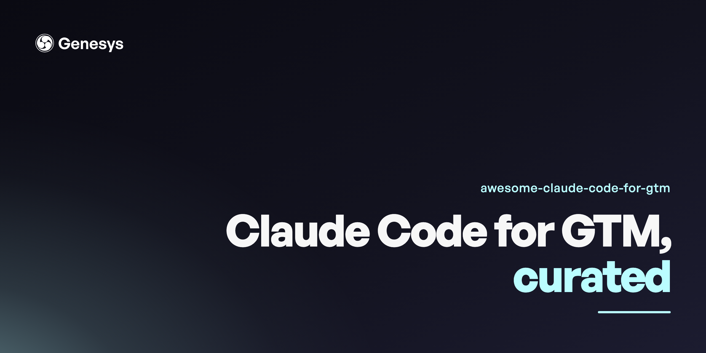

# Awesome Claude Code for GTM 

> Skills, agents, MCP servers, and workflows that put Claude Code to work on go-to-market problems.

Go-to-market work is mostly reading, writing, and moving structured data between systems, which is exactly what an agent harness is good at. This list collects the parts that already exist: skill libraries you can install, MCP servers that reach your CRM and enrichment stack, agent collections, and the research on whether any of it works.

Entries are alphabetical within each section. Star counts and dates were verified on 2026-07-16.

## Contents

- [How Claude Code Works for GTM](#how-claude-code-works-for-gtm)
- [Skill Libraries](#skill-libraries)
- [Marketing and GTM Skills](#marketing-and-gtm-skills)
- [Quickstarts](#quickstarts)
- [Agents and Subagents](#agents-and-subagents)
- [Plugins](#plugins)
- [MCP Servers for GTM](#mcp-servers-for-gtm)
- [GTM Tool Guides](#gtm-tool-guides)
- [Writing and Output Utilities](#writing-and-output-utilities)
- [Research](#research)
- [Courses and Communities](#courses-and-communities)

---

## How Claude Code Works for GTM

The mechanics of running GTM work inside an agent harness: what a skill is, how MCP connects an agent to your stack, and where the whole thing breaks down.

- [Agent Skills documentation](https://docs.claude.com/en/docs/agents-and-tools/agent-skills) - Anthropic's reference for the skill format: the `SKILL.md` frontmatter contract, progressive disclosure of reference files, and how the model decides a skill is relevant. The frontmatter `description` field is the whole triggering mechanism, which is the single most common thing people get wrong.
- [AI-Powered GTM Workflows](https://www.genesysgrowth.com/blog/ai-powered-gtm-workflows-complete-guide) - Walks the full loop from research through positioning to shipped asset, treating the agent as an embedded operator rather than a copywriting box. Covers where the handoffs between research, strategy, and execution actually break, and why most GTM automation stalls at the point where a human has to re-explain context the agent already had.
- [AI Prompt Engineering for Marketers](https://www.genesysgrowth.com/blog/ai-prompt-engineering-for-marketers-complete-guide) - Prompt patterns aimed at marketing outputs specifically, where the failure mode is not a wrong answer but a plausible one in the wrong voice. Covers the difference between prompting for a draft and prompting for a decision.
- [Claude Code documentation](https://docs.claude.com/en/docs/claude-code/overview) - Official docs for the CLI: hooks, slash commands, subagents, settings, and MCP configuration. The hooks and settings pages matter most for GTM work, because that is where you enforce voice rules and spend gates that the model would otherwise talk itself out of.
- [Genesys Growth AI info](https://www.genesysgrowth.com/ai-info) - Structured summary of the practice, written to be machine-readable as much as human-readable.
- [How to build your AI GTM system](https://newsletter.genesysgrowth.com/p/how-to-build-your-ai-gtm-system) - Matteo Tittarelli and Kyle Poyar on the context layer most AI GTM stacks are missing. Lays out a four-tier system: a system of context (ICP, competitors, positioning, brand as a folder hierarchy), a system of skills that turn that context into research, strategy, and execution outputs, orchestration agents that fire skills on signals, and integrations that pull external data and push finished work to live destinations. The argument worth taking seriously is that compounding lives in the contextual spine and the folder structure, not in better prompts or more agents. Implementation runs on Claude Code, GitHub repos for team sharing, and MCP servers at both ends.
- [Model Context Protocol documentation](https://modelcontextprotocol.io/) - The open protocol that lets an agent call your CRM, enrichment provider, or analytics warehouse. Read the transports page before building anything; the difference between stdio and HTTP servers determines whether your GTM stack works in a cron job or only on your laptop.
- [The Genesys](https://newsletter.genesysgrowth.com/) - Matteo Tittarelli's newsletter on AI-native GTM practice: context systems, skills, and the tooling underneath them. Where the article above was published.
- [The GTM Engineer Pulse](https://gtmengineerschool.substack.com/) - Weekly newsletter from GTM Engineer School covering GTM engineering news and tooling.

## Skill Libraries

General-purpose skill collections. Most contain some GTM-adjacent material even when that is not their focus.

- [agentic-awesome-skills](https://github.com/sickn33/agentic-awesome-skills) - Installable library of 1,900+ agent skills spanning Claude Code, Cursor, Codex CLI, and Gemini. Breadth over depth, so treat it as a starting point to fork rather than a curated set. 43,394 stars, actively maintained.
- [alirezarezvani/claude-skills](https://github.com/alirezarezvani/claude-skills) - 345 skills bundled with 30+ agents and 70+ custom commands, packaged so the whole thing installs as a unit. Useful if you want a working configuration to strip down rather than a blank harness. 22,703 stars.
- [anthropics/skills](https://github.com/anthropics/skills) - Anthropic's own public skills repository and the reference implementation of the format. Read these first: `docx`, `pptx`, and `xlsx` show how a skill handles binary formats, and `skill-creator` is the canonical example of a skill that authors other skills. 161,607 stars.
- [borghei/Claude-Skills](https://github.com/borghei/Claude-Skills) - 343 skills and 76 expert agents organised by function, including marketing and PM tracks, alongside a Python stdlib of 835 tools. The `standards/` directory is the interesting part: it documents orchestration protocols rather than just shipping prompts. MIT with Commons Clause, so check the licence before commercial reuse. 378 stars.
- [VoltAgent/awesome-agent-skills](https://github.com/VoltAgent/awesome-agent-skills) - 1,000+ skills gathered from official dev teams and the community, cross-compatible across harnesses. 28,210 stars.

## Marketing and GTM Skills

Skill libraries built specifically for marketing, sales, and revenue work.

- [aaron-marketing-skills](https://github.com/aaron-he-zhu/aaron-marketing-skills) - 120 marketing skills and 8 commands across seven disciplines including SEO/GEO and influencer work. 2,396 stars.
- [affiliate-skills](https://github.com/Affitor/affiliate-skills) - 50 skills for affiliate marketing: trend research, data-backed post generation, and creative production. Narrow but honest about its scope. 548 stars.
- [agentkits-marketing](https://github.com/aitytech/agentkits-marketing) - Marketing automation skills targeting Claude Code, Cursor, and Copilot, pitched at team rather than solo use. 566 stars.
- [ai-business-skills](https://github.com/minhnv0807/ai-business-skills) - 63 bilingual marketing skills (Vietnamese and English), which is unusual in this space and useful if you run non-English GTM. 499 stars.
- [ai-marketing-claude](https://github.com/zubair-trabzada/ai-marketing-claude) - 15 marketing skills built around parallel subagents, including a website audit that fans out across pages concurrently. Worth reading for the fan-out pattern even if you do not use the skills. 2,131 stars.
- [aso-skills](https://github.com/Eronred/aso-skills) - App Store Optimization and app marketing skills, aimed at indie developers and app marketers. The only serious ASO-focused set here. 1,629 stars.
- [claude-blog](https://github.com/AgriciDaniel/claude-blog) - Blog skill suite with 30 sub-skills, 5 agents, and a gated delivery contract that dual-optimises for search and AI citation. The gate structure is the transferable idea. 1,397 stars.
- [founder-skills](https://github.com/firatcand/founder-skills) - Skills for founders building B2B SaaS, covering GTM alongside product, engineering, and design. Small and opinionated. 26 stars.
- [genesys-skills](https://github.com/matteotitta/genesys-skills) - Product marketing and GTM skills used in live consulting engagements: positioning, messaging, competitor research, ICP work, and content. Maintained by the author of this list and shared weekly through the Genesys newsletter. 15 stars.
- [makerskills](https://github.com/coreyhaines31/makerskills) - Skills for the solo operator's craft: decisions, research, second-brain, scenario modeling, and meta-skills for authoring further skills. MIT. 138 stars.
- [marketing-skills](https://github.com/kostja94/marketing-skills) - 160+ open-source skills across SEO, content, social, and influencer marketing. 737 stars.
- [marketingskills](https://github.com/coreyhaines31/marketingskills) - The most substantial marketing skill library here, covering CRO, copywriting, SEO, analytics, and growth engineering. MIT-licensed and actively maintained, which makes it the safest base to fork for client work. 40,113 stars.
- [gtm-engineer-skills](https://github.com/onvoyage-ai/gtm-engineer-skills) - Scores a website for answer-engine visibility across 16 foundational checks and 6 intelligence dimensions. One of the few skills here aimed at AEO measurement rather than content generation. 1,250 stars.
- [gtm-skills/gtm](https://github.com/gtm-skills/gtm) - GTM toolkit for agents covering research, intel, outreach, and CRM. Last pushed February 2026, so treat it as a reference rather than a live dependency. 116 stars.
- [NotFair](https://github.com/nowork-studio/NotFair) - Open-source skills for SEO, GEO, Google Ads, and Meta Ads. The only set here that covers paid and organic in one place. 3,138 stars.
- [openclaudia-skills](https://github.com/OpenClaudia/openclaudia-skills) - Marketing skills spanning SEO, content, email, ads, analytics, and growth. Small enough to read end to end. Note the repo description and readme disagree on the skill count. 573 stars.
- [pm-skills](https://github.com/phuryn/pm-skills) - Product management skills marketplace with 100+ skills, commands, and plugins across discovery, strategy, execution, launch, and growth. The launch and growth tracks are the GTM-relevant ones. 23,844 stars.
- [rampstackco/claude-skills](https://github.com/rampstackco/claude-skills) - Stack-agnostic skills covering the full website lifecycle: brand, design, content, SEO, development, ops, and growth. 461 stars.
- [seo-skill-bench](https://github.com/aleclindz/seo-skill-bench) - Open benchmark that runs SEO skills headlessly against fixture sites and scores them. The only attempt here at measuring whether these skills actually work, which makes it more interesting than its star count suggests. 111 stars.
- [wholesaler-claude-skills](https://github.com/miron-tech/wholesaler-claude-skills) - Six skills for real estate wholesalers covering property recon, conversation coaching, and creative financing. Included as a worked example of vertical-specific GTM skills. 38 stars.

## Quickstarts

- [claude-code-marketing-quickstart](https://github.com/matteotitta/claude-code-marketing-quickstart) - Scaffolds a working Claude Code setup for marketing work: skills, agents, and a folder convention that survives more than one project. Aimed at marketers who have not run a CLI harness before. Maintained by the author of this list. 35 stars.
- [claude-code-tips](https://github.com/ykdojo/claude-code-tips) - 40+ tips from basics to advanced, including a custom status line setup. Not a scaffold, but the fastest way to stop making beginner mistakes. 9,302 stars.

## Agents and Subagents

- [awesome-claude-code-sub-agents](https://github.com/supatest-ai/awesome-claude-code-sub-agents) - Collection of specialised subagents. Smaller than the VoltAgent set and last updated September 2025, so check freshness before relying on it. 165 stars.
- [VoltAgent/awesome-claude-code-subagents](https://github.com/VoltAgent/awesome-claude-code-subagents) - 100+ specialised subagents across a wide range of use cases. The value for GTM work is the dispatch patterns rather than the agents themselves. 23,387 stars.
- [wshobson/agents](https://github.com/wshobson/agents) - Multi-harness agentic plugin marketplace spanning Claude Code, Codex CLI, Cursor, and Copilot. The largest agent collection here and the most cross-compatible. 37,954 stars.

## Plugins

- [claude-hud](https://github.com/jarrodwatts/claude-hud) - Shows context usage, active tools, running agents, and todo state while Claude Code works. Context usage is the number that matters on long GTM research runs, and this is the cheapest way to see it. 26,461 stars.
- [claude-plugins-official](https://github.com/anthropics/claude-plugins-official) - Anthropic's managed directory of vetted Claude Code plugins. Start here before installing anything from a random marketplace. 32,204 stars.
- [codex-plugin-cc](https://github.com/openai/codex-plugin-cc) - OpenAI's plugin for calling Codex from inside Claude Code, for review or delegation. Notable mostly as evidence that the harnesses are converging. 28,924 stars.
- [compound-engineering-plugin](https://github.com/EveryInc/compound-engineering-plugin) - Every's plugin built around the idea that each shipped change should make the next one cheaper. The product-pulse and ship-learnings patterns port cleanly to GTM. 23,251 stars.

## MCP Servers for GTM

Servers that connect an agent to the GTM stack. This is a shortlist; [awesome-gtm-mcp-servers](https://github.com/matteotitta/awesome-gtm-mcp-servers) is the full catalogue with per-vendor coverage and the gaps stated explicitly.

Two things worth knowing before you wire anything up. **No first-party MCP server exists for Google Ads, Meta Ads, LinkedIn Ads, Semrush, Mixpanel, Search Console, Clay, Hunter, Pipedrive, or Close** — GTM's highest-spend surfaces are entirely community-built, which is worth weighing before you hand one a budget. And **vendors are migrating to hosted servers**: Ahrefs and PostHog both archived their local repos in favour of remote endpoints, while HubSpot, Apollo, and Attio are hosted-first with no meaningful public repo. A repo-only view of this space is already wrong.

- [apify/apify-mcp-server](https://github.com/apify/apify-mcp-server) - Apify's official server exposing thousands of ready-made scrapers to an agent, covering social, search, maps, and e-commerce extraction. Supports OAuth so hosted clients can connect by URL alone. Formerly `actors-mcp-server`; publish this path. 1,963 stars.
- [exa-labs/exa-mcp-server](https://github.com/exa-labs/exa-mcp-server) - Exa's official server for neural web search and crawling. 4,728 stars.
- [firecrawl/firecrawl-mcp-server](https://github.com/firecrawl/firecrawl-mcp-server) - Firecrawl's official server for scraping, crawling, search, and structured extraction; the highest-starred MCP server in the GTM stack. Note the org rename: `mendableai/firecrawl-mcp-server` redirects here, and most lists still cite the stale path. 6,969 stars.
- [gtm-mcp](https://github.com/impecablemee/gtm-mcp) - Open-source B2B cold outreach pipeline rather than a vendor server. One `/launch` command finds companies through Apollo, classifies them, and drafts outreach. The most complete open GTM pipeline here, though small. 62 stars.
- [HubSpot MCP Server](https://developers.hubspot.com/mcp) - HubSpot's official hosted server at `mcp.hubspot.com`, with read and write access to CRM objects and engagements. Hosted only. Ignore `HubSpot/mcp-server` on GitHub: it exists under the real org but is an empty placeholder.
- [mcp-gsc](https://github.com/AminForou/mcp-gsc) - The de-facto Search Console server, since Google publishes none. 1,174 stars.
- [modelcontextprotocol/registry](https://github.com/modelcontextprotocol/registry) - The official registry service, and where `modelcontextprotocol/servers` now sends you for third-party servers. 7,027 stars.
- [modelcontextprotocol/servers](https://github.com/modelcontextprotocol/servers) - The canonical reference servers, maintained by the MCP steering group. Worth knowing it no longer carries a third-party integrations list. 88,543 stars.
- [salesforcecli/mcp](https://github.com/salesforcecli/mcp) - Salesforce's official server, maintained by the CLI team. Apache-2.0. 440 stars.
- [twenty-crm-mcp-server](https://github.com/mhenry3164/twenty-crm-mcp-server) - MCP server for Twenty, the open-source CRM. The pairing matters: an open CRM plus an open server is the only fully inspectable CRM-agent stack here. 68 stars.

## GTM Tool Guides

Guides to the tools the servers above connect to, covering what each one is for and where it stops. These are the maintainer's own write-ups; see [contributing.md](contributing.md) for the disclosure.

- [Apollo](https://www.genesysgrowth.com/tools/apollo-io) - Contact database and sequencer. Note this is Apollo.io, not the Apollo GraphQL project, which publishes a similarly-named MCP server and is unrelated to GTM work.
- [Attio](https://www.genesysgrowth.com/tools/attio) - Modern CRM with a strong API, which makes it the easiest CRM to drive from an agent.
- [Clay](https://www.genesysgrowth.com/tools/clay) - Enrichment and waterfall orchestration across many providers.
- [Common Room](https://www.genesysgrowth.com/tools/common-room) - Signal capture across community, product usage, and job changes.
- [Gong](https://www.genesysgrowth.com/tools/gong) - Call recording and revenue intelligence; the source of the transcripts most win-loss work runs on.
- [HubSpot](https://www.genesysgrowth.com/tools/hubspot) - CRM and marketing automation.
- [lemlist](https://www.genesysgrowth.com/tools/lemlist) - Outbound sequencing across email and LinkedIn.

## Writing and Output Utilities

The parts that stop agent output from reading like agent output.

- [caveman](https://github.com/JuliusBrussee/caveman) - Cuts roughly 65% of tokens by stripping prose to essentials. A blunt instrument, but the token maths on long research runs is real. 90,082 stars.
- [humanizer](https://github.com/blader/humanizer) - Removes the tells of AI-generated writing. The most directly useful utility here for anyone publishing agent-drafted copy under their own name. 29,458 stars.

## Research

Evidence on whether any of this changes outcomes. Thin, and worth being honest about that.

- [GEO: Generative Engine Optimization](https://arxiv.org/abs/2311.09735) - Aggarwal et al. introduced systematic testing of generative-engine interventions and the benchmark most later work cites.
- [What Drives Citations in Production Large Language Models?](https://discoveredlabs.com/research/what-drives-ai-citations) - Discovered Labs' observational study of roughly 2 million citations across ChatGPT, Claude, Google AI, and Gemini, joined to 10,000 crawled pages. Finds prompt-content alignment to be the dominant page-level predictor (β = +0.37) and, more usefully, finds that the standard AEO checklist of FAQ blocks, structured data, and Core Web Vitals collapses toward zero once domain fixed effects are applied. Read the limitations section: it is observational, scoped to 19 B2B SaaS workspaces, and cannot establish causation.
- [Ranking Manipulation for Conversational Search Engines](https://arxiv.org/abs/2406.03589) - Kumar and Lakkaraju show that strategic lexical insertion measurably shifts LLM recommendation probability, which is the uncomfortable counterpart to any content-alignment finding.

## Courses and Communities

- [Clay University](https://www.clay.com/university) - Free training on Clay specifically, and the best on-ramp to enrichment waterfalls.
- [GTM Engineer School](https://www.gtm-engineer-school.com/) - Cohort-based course teaching GTM operators to build AI-driven workflows, structured around a find-enrich-transform-export framework. Co-founded by the author of this list.
- [RevOps Co-op](https://www.revopscoop.com/) - Community for revenue operations practitioners, and the most active general RevOps forum.

## Related Lists

- [awesome-aeo-seo](https://github.com/discoveredlabs/awesome-aeo-seo) - Answer engine optimisation resources from the team behind the citation-drivers study above.
- [awesome-claude-code](https://github.com/hesreallyhim/awesome-claude-code) - The general Claude Code list, and the best starting point for anything not GTM-specific. 50,147 stars.
- [awesome-generative-engine-optimization](https://github.com/amplifying-ai/awesome-generative-engine-optimization) - The largest GEO list. Last pushed April 2026. 448 stars.
- [awesome-gtm-engineering](https://github.com/marketinguys/awesome-gtm-engineering) - GTM engineering tools and resources. One commit, unmaintained since June 2025, but still a useful snapshot of the tool landscape. 120 stars.
- [awesome-mcp-servers](https://github.com/punkpeye/awesome-mcp-servers) - The comprehensive MCP server list. 90,842 stars.
